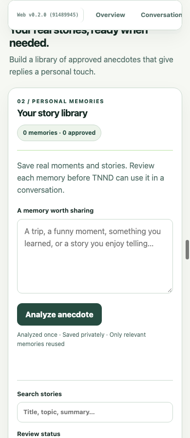
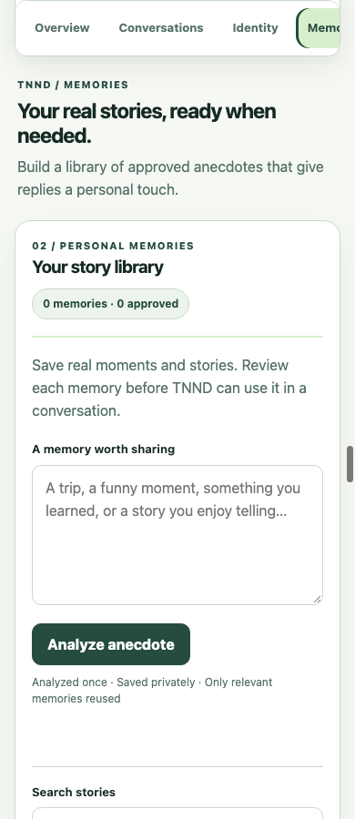
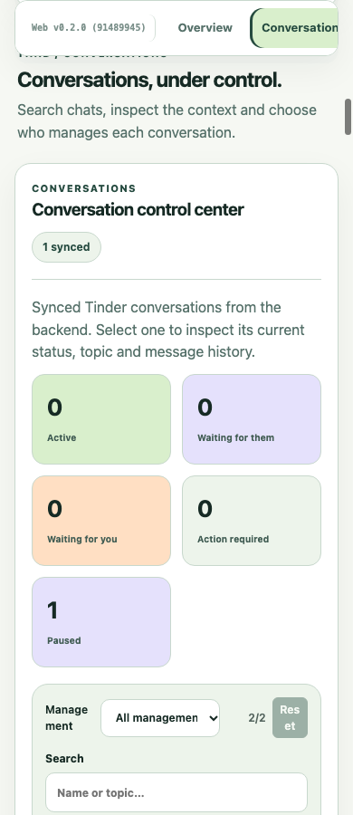
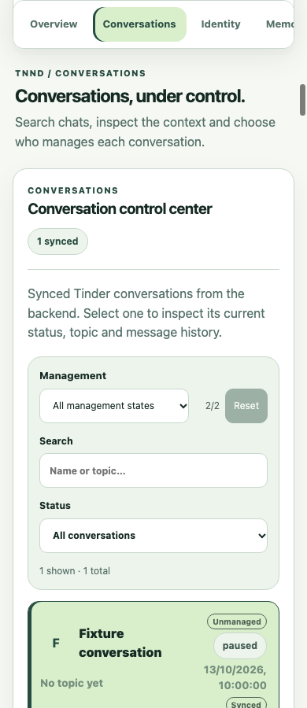
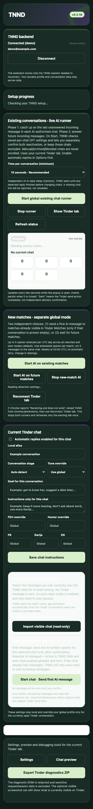
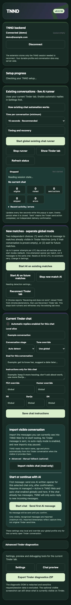

# TNND — audit UX/UI sur écrans rendus (14 octobre 2026)

## Cadre et état initial

- Base : `main` à `9148994` ; aucune PR ouverte lors du contrôle GitHub. Le dépôt local contenait trois `package-lock.json` non suivis, laissés intacts.
- Docker : Web `:5173`, API `:4000` et PostgreSQL démarrés ; API et base signalées saines.
- Référence : Neo Bento (`docs/design/PRODUCT_PROFILE.md`, `docs/design/neo-bento.md`). Le fichier Figma fourni n'était pas accessible depuis les outils de lecture de cet environnement ; aucune parité Figma n'est revendiquée.
- Les captures proviennent du **vrai bundle TNND rendu dans Chrome** avec un compte et une API synthétiques, ou des pages HTML/CSS de l'extension avec scripts désactivés. Aucun profil, message ou jeton réel n'a été utilisé. Les captures de l'extension montrent des états visuels simulés, pas la connexion réelle à Tinder.

## Parcours et écrans vérifiés

| Étape | Surface | État après correction | Preuve représentative |
| --- | --- | --- | --- |
| 1 | Overview et guide initial | Lisible ; étape et action suivante visibles | [390 px](assets/2026-10-14-rendered/after-01-overview-light-390.png), [1440 px](assets/2026-10-14-rendered/after-01-overview-light-1440.png) |
| 2 | Conversations, recherche, filtres, chat et brouillon | Navigation et priorité du chat corrigées ; flux fonctionnel synthétique validé | [390 px](assets/2026-10-14-rendered/after-02-conversations-light-390.png), [375 px sombre](assets/2026-10-14-rendered/after-02-conversations-dark-375.png) |
| 3 | Identity Builder | Formulaire visible ; analyse/approbation réelle non vérifiée | [390 px](assets/2026-10-14-rendered/after-03-identity-light-390.png) |
| 4 | Personal Memories | Ajout et filtres visibles à l'état vide ; revue/approbation réelle non vérifiée | [390 px](assets/2026-10-14-rendered/after-04-memories-light-390.png) |
| 5 | Action Center | État vide et prochaine action compréhensibles ; cas avec demande en attente non capturé | [390 px](assets/2026-10-14-rendered/after-05-action-center-light-390.png) |
| 6 | Analytics | Valeurs de fixture rendues sans débordement ; données réelles non évaluées | [390 px](assets/2026-10-14-rendered/after-06-analytics-light-390.png) |
| 7 | Settings | Groupes et champs accessibles, page encore longue sur téléphone | [390 px](assets/2026-10-14-rendered/after-07-settings-light-390.png) |
| 8 | Popup extension, déconnecté/connecté/attente/erreur | Aide repliable et contrastes sombres corrigés ; comportement réel de sync non vérifié | [Déconnecté](assets/2026-10-14-rendered/after-popup-logged-out-light-380.png), [connecté sombre](assets/2026-10-14-rendered/after-popup-chat-open-dark-380.png), [erreur](assets/2026-10-14-rendered/after-popup-sync-error-light-380.png) |
| 9 | Options et Preview extension | Rendus clairs/sombres vérifiés ; génération réelle non déclenchée | [Options](assets/2026-10-14-rendered/after-options-dark-375.png), [Preview](assets/2026-10-14-rendered/after-preview-dark-390.png) |
| 10 | Interface injectée sur Tinder | Non vérifiée : aucun contexte de test Tinder sûr avec conversation consentie n'était disponible | Aucune capture |

La matrice Web complète comporte **70 captures avant et 70 après** : sept vues, cinq largeurs (1440, 1280, 840, 390 et 375 px), deux thèmes. La matrice extension finale comporte **32 captures** : popup à 380 px (et variantes 375/390), options et preview à 1440, 1280, 840, 390 et 375 px, en clair et sombre. Les matrices complètes et leurs rapports JSON restent dans les livrables locaux de cet audit ; les captures ci-dessus sont conservées dans le dépôt pour la revue de PR.

## Problèmes classés

| Priorité | Écran | Constat observé | Traitement |
| --- | --- | --- | --- |
| P1 | Navigation Web mobile | Les liens visaient l'intérieur des panneaux : les titres de Memories, Action Center et Settings passaient sous la barre fixe. | Corrigé : liens vers le début de chaque section, ancien ancrage profond conservé, décalage de défilement ajusté. |
| P1 | Conversations mobile | Cinq compteurs précédaient la recherche et la liste ; le chat n'apparaissait pas dans le premier écran à 390 px. | Corrigé : recherche, liste et détail avant les compteurs. |
| P1 | Popup sombre | Le bloc d'import, l'état du runner et le libellé des diagnostics avancés avaient un fond clair et un texte trop pâle. | Corrigé avec les couleurs sémantiques Neo Bento ; vérifié sur captures sombres. |
| P2 | Conversations mobile | « Management » et « Reset » se repliaient en mots étroits, avec une cible trop petite. | Corrigé : vrai label associé, grille stable, bouton de 44 px. |
| P2 | Paramètres Web / contrôles avancés | Trois boutons d'exemple mesuraient 36 px de haut ; l'audit des contrôles signalait 13 autres petites cibles dans Conversations. | Corrigé : minimum 44 × 44 px dans les panneaux ; audit synthétique final sans alerte de petite cible. |
| P2 | Conversation Flow | Libellés français et détail de réponse API technique au milieu d'une interface anglaise. | Corrigé : vocabulaire anglais et conseil de reprise compréhensible. |
| P2 | Popup extension | Instructions d'automatisation longues avant l'action principale. | Corrigé en partie : prérequis visible, explications secondaires repliables. Le popup reste dense. |
| P1 ouvert | Conversations | La liste montre la date du dernier message, sans extrait du dernier message synchronisé. | À traiter avec le contrat API et la confidentialité : le résumé fourni au Web ne contient que `lastMessageAt`. |
| P2 ouvert | Options extension / Settings Web | Formulaires très longs sur téléphone ; la progression et les groupes méritent une passe dédiée. | Non modifié dans cette PR. |
| P2 ouvert | États réels | Sync/erreur, approbation de mémoire, action humaine en attente, identité avec âge/photo et confirmation d'envoi demandent des données de test adaptées. | Captures de fixtures seulement ; tests réels encore requis. |

Les états « zéro conversation » et « aucun résultat de filtre » étaient déjà distincts dans `main`. Le guide et la hiérarchie du brouillon avaient aussi été corrigés dans les commits précédents ; ils n'ont pas été refaits.

## Comparaisons avant / après

| Correction | Avant | Après |
| --- | --- | --- |
| Titre de Memories sur téléphone |  |  |
| Recherche et chat Conversations |  |  |
| Popup connecté sombre |  |  |

## Vérifications et limites

- `npm run build` racine : réussi, incluant le build extension et les régressions de sécurité existantes.
- Web : `npm run typecheck`, `npm test`, `npm run build` réussis.
- QA Chrome avec API synthétique : **22 contrôles fonctionnels réussis**, navigation des 7 sections, brouillon, validation locale sans envoi, erreur et reprise ; audit des 57 boutons visibles et 17 disclosures sans alerte finale. Le port du serveur de fixture a été adapté localement car `:5173` était occupé par Docker ; le script CI original n'a pas été modifié.
- Extension : **32 captures finales** ; smoke visuel sans débordement horizontal ni bouton de moins de 44 px dans les surfaces capturées.
- Web : **70 captures finales** ; aucun débordement horizontal détecté et aucun bouton visible de moins de 44 px de haut dans les vues capturées. À 390 px, les titres de section sont à 76 px du haut, sous la navigation à 62 px.
- L'audit visuel ne prouve pas la conformité WCAG complète : focus clavier, lecteur d'écran, contraste de chaque texte et zoom restent à tester manuellement.
- Aucun vrai message Tinder envoyé, aucune action de suppression, aucun changement de permission, de sélecteur DOM ou de garde d'envoi. L'envoi externe confirmé et la prise en main manuelle restent des éléments ouverts du V1 Release Gate.
- La CI GitHub et la PR seront consignées dans le suivi de la branche ; une compilation locale ne vaut pas validation des workflows distants.
